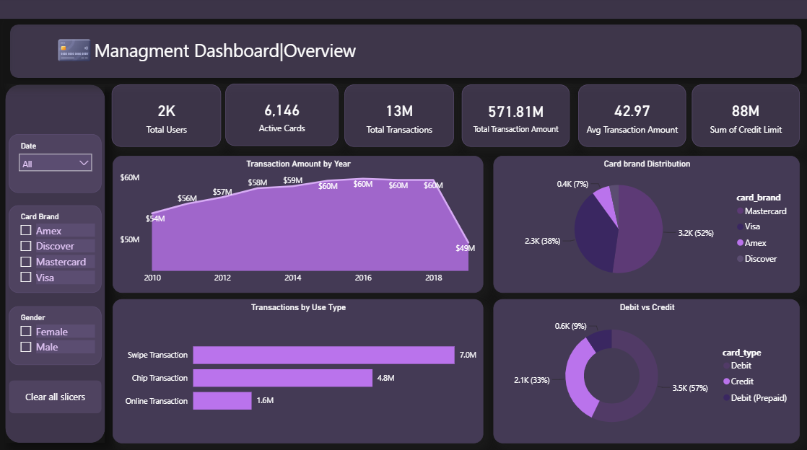
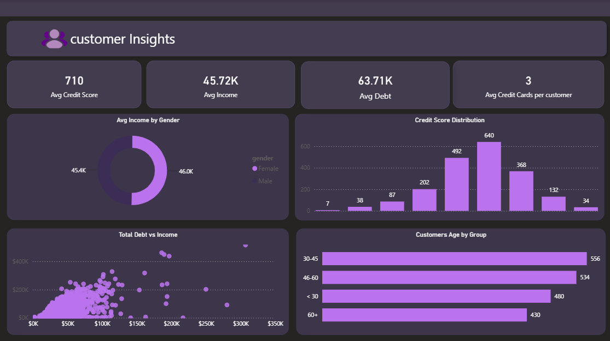
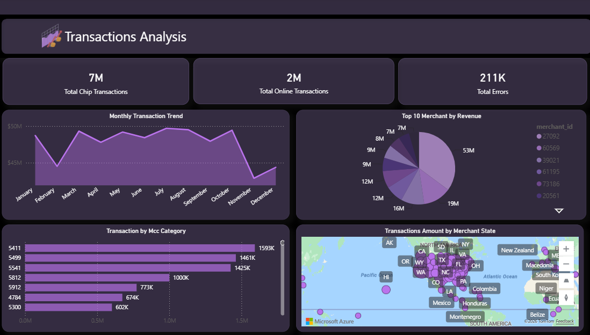
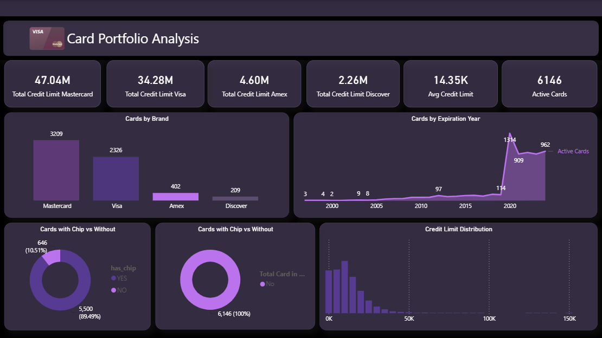

# power-bi-management-dashboard
An interactive Power BI dashboard for management analysis
# 📊 Power BI Management Dashboard

An interactive and comprehensive **Power BI Dashboard** designed for management analysis. This project provides actionable data insights across key business areas, including customer behavior, risk management, and transaction analysis, to support data-driven decision-making.

---

## 🚀 Live Demo & Visuals

Here is a preview of the main pages and analysis included in this Power BI report:

### 1. Main Dashboard Page
Overview of the primary management KPIs and high-level business performance metrics.


### 2. Customer Insights
Deep dive into customer demographics, retention rates, and behavioral patterns.


### 3. Risk & Fraud Detection
Advanced monitoring for security, risk assessment, and anomaly/fraud detection.


### 4. Transactions Analysis
Detailed breakdown of revenue streams, transaction volumes, and financial trends.


### 5. Card Portfolio Analysis
Analysis of card performance, usage distribution, and portfolio health.


---

## 🛠️ Built With

* **Power BI Desktop** - For data modeling, DAX calculations, and visual report design.
* **Power Query** - For ETL (Extract, Transform, Load) data cleaning processes.

---

## 🎯 Key Features

* **Interactive Filters:** Seamlessly slice and dice data by date range, region, and customer segments.
* **Advanced DAX:** Tailored measures and columns to calculate complex business KPIs.
* **Role-Based Perspectives:** Designed to give executives and team leads immediate clarity.

---

## ⚙️ How to Use

1. **Clone the Repository:**
   ```bash
   git clone https://github.com
   ```
2. **Open the Report:** Open the `.pbix` file (if uploaded later) using **Power BI Desktop**.
3. **Refresh Data:** Update the data source connections to point to your local dataset to update the visuals.
